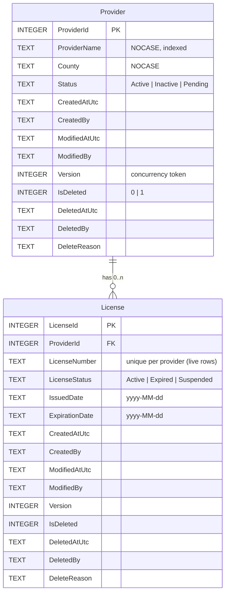

# Provider Licensing

A small internal system that manages **providers** and their **licenses**, built for the Senior Full-Stack .NET Modernization Developer take-home assignment.

- **React UI** (TypeScript, Vite) for listing, creating, editing and soft-deleting providers, viewing licenses, the required license reports, an audit view of deleted providers, and an optional dashboard.
- **ASP.NET Core 8 Web API** (C#) that owns all business rules: validation, soft deletion, license validity and concurrency.
- **SQLite** through **Entity Framework Core 8**, with constraints, triggers and views in the database as well.

Hard deletion is not possible anywhere: not through the API, not through EF Core, and not through raw SQL.

The requirements come from the assignment PDF in this repository ([assignment/Take-Home_Technical_Assignment_Formatted.pdf](assignment/Take-Home_Technical_Assignment_Formatted.pdf)), which specifies a React UI with a C# Web API.

---

## Contents

1. [Quick start](#quick-start) (including [verification steps](#verification-steps))
2. [Solution structure](#solution-structure) and [technology choices](#technology-choices)
3. [Database design](#database-design)
4. [Soft delete](#soft-delete)
5. [License validity and the required scenarios](#license-validity-and-the-required-scenarios)
6. [API](#api)
7. [How the React UI communicates with the API](#how-the-react-ui-communicates-with-the-api)
8. [Dashboard (optional enhancement)](#dashboard-optional-enhancement)
9. [Sample data](#sample-data)
10. [Testing](#testing)
11. [Assumptions](#assumptions)
12. [Trade-offs](#trade-offs)
13. [What I would improve with more time](#what-i-would-improve-with-more-time)

---

## Quick start

### Prerequisites

- [.NET 8 SDK](https://dotnet.microsoft.com/download/dotnet/8.0) (or newer, with the .NET 8 targeting pack)
- [Node.js](https://nodejs.org/) LTS (tested with Node 22) and npm
- Optional: Visual Studio 2022 17.7+ with the **ASP.NET and web development** and **Node.js development** workloads

### Run from the command line (two terminals)

```bash
# Terminal 1 - API on http://localhost:5264 (Swagger UI at /swagger)
dotnet run --project backend/Candidate.API
```

```bash
# Terminal 2 - React UI on http://localhost:5173
cd frontend/React.UI
npm ci
npm run dev
```

Open **http://localhost:5173**. The UI calls `/api/...` on its own origin, and the Vite dev server forwards those requests to the API (see [How the React UI communicates with the API](#how-the-react-ui-communicates-with-the-api)).

### Run from Visual Studio 2022

1. Run `npm ci` once in `frontend/React.UI`.
2. Open `CandidateAssessment.sln`.
3. Right-click the solution → **Configure Startup Projects** → **Multiple startup projects** → set **Candidate.API** and **React.UI** to **Start**.
4. Press F5. Either API launch profile (`http` or `https`) works, because both listen on `http://localhost:5264`, which is where the Vite proxy sends requests.

### Database

The committed database [backend/Candidate.API/Database/Data/providers.db](backend/Candidate.API/Database/Data/providers.db) already contains the sample data, so nothing needs to be set up.

In Development, the API applies any pending EF Core migrations at startup and seeds the sample data if the database is empty (`Database:MigrateAndSeedOnStartup` in `appsettings.Development.json`). **To reset the data**, stop the API, delete `providers.db`, and start the API again.

The same database can be built with plain SQL; see [Database scripts](#database-scripts).

### Verification steps

From a clean checkout, with Node.js and the .NET SDK on `PATH`:

```bash
dotnet restore
dotnet build CandidateAssessment.sln
dotnet test backend/Candidate.API.Tests
cd frontend/React.UI
npm ci
npm run build
```

Then confirm both applications start (two terminals):

```bash
dotnet run --project backend/Candidate.API
```

```bash
cd frontend/React.UI
npm run dev
```

Expected results:

- The solution build succeeds for `Candidate.API`, `Candidate.API.Tests` and `React.UI` with no warnings, and all 48 tests pass.
- `npm run build` type-checks the UI (`tsc`) and produces `dist/`.
- The API stays running with no startup exception. In Development, Swagger UI (http://localhost:5264/swagger) lists the provider, report, audit, lookup and dashboard operations.
- The React development server stays running. http://localhost:5173 shows the provider list loaded from the API (12 providers; the 2 soft-deleted ones are not listed).
- Solution Explorer shows three projects: `Candidate.API`, `Candidate.API.Tests` (under `backend`) and `React.UI` (under `frontend`).
- Starting the apps does not modify any tracked file (the committed database is only read until data is changed).

---

## Solution structure

```text
CandidateAssessment.sln
backend/
  Candidate.API/
    Domain/            Provider, License, status enums, LicenseRules (the license-validity rules)
    Data/              AppDbContext (query filters), entity configurations, interceptors,
                       migrations, seeder
    Services/          Business logic: ProviderService (commands), ProviderQueryService,
                       ReportService, AuditService, DashboardService
    Controllers/       Thin HTTP layer: one service call, then map the result to a response
    Contracts/         Request/response records (entities are never returned)
    Infrastructure/    Current-user stub, database exception handler, clock helpers
    Database/
      Data/providers.db
      Scripts/         01-05 SQL scripts (schema, triggers, views, seed data, scenario queries)
  Candidate.API.Tests/ xUnit: unit, data-layer (real SQLite) and HTTP integration tests
frontend/React.UI/
  src/api/             Typed API client and endpoint functions (mirror of Contracts/)
  src/hooks/useApi.ts  Loading / error / reload state for API calls
  src/components/      Shared UI: badges, states, confirm dialog, license table, bar list
  src/features/        providers/, reports/, audit/, dashboard/ pages
assignment/            Assignment PDF
```

**Why a single API project?** The domain has two entities and a handful of rules. Splitting it into Domain, Application, Infrastructure and Web projects would add more ceremony than clarity. The code is still layered *inside* the project:
- Controllers only handle HTTP.
- Services own the rules.
- Data owns persistence.
- `Domain/LicenseRules.cs` has no dependencies.

The point to split is when a second host appears (for example a background job that needs the same services), or when the domain grows.

### Technology choices

| Choice | Why |
| --- | --- |
| **.NET 8**, ASP.NET Core Web API with controllers | Matches the starter (`net8.0`). Controllers with `[ApiController]` give automatic model validation and RFC 7807 problem responses. |
| **EF Core 8.0.32** with the SQLite provider, plus the local `dotnet-ef` tool (`.config/dotnet-tools.json`) | Required by the assignment. Pinning the tool means everyone generates migrations with the same version. |
| **React 19 with TypeScript** (converted from the starter's JavaScript) | The typed API contract in `src/api/types.ts` mirrors the C# records, so a mismatch between UI and API is a build error rather than a runtime bug. |
| **react-router 7** | Every page and filter has its own URL (e.g. `/providers?status=Active&county=Fulton`, `/reports?view=expired`), so views can be bookmarked and the back button works. |
| **Vite dev proxy** | The UI calls the API on its own origin; no CORS setup or hard-coded host is needed in development (details [below](#how-the-react-ui-communicates-with-the-api)). |
| **No UI component or charting library** | The screens need tables, forms, a dialog and two small bar charts, which plain React and CSS cover. That means fewer dependencies to maintain and full control over accessibility. The styling is a skeuomorphic theme (paper panels, raised buttons, inset fields) built only from CSS gradients and shadows. |
| **xUnit**, `WebApplicationFactory`, `FakeTimeProvider`, real SQLite in memory | Tests run against the real database engine and migrations (constraints and triggers included) and against the real HTTP pipeline, with a controllable clock for the date rules. |

**Commands vs queries.** `ProviderService` changes data. `ProviderQueryService`, `ReportService` and `DashboardService` only read, using `AsNoTracking` and projections straight into DTOs. `AuditService` is the only class allowed to see soft-deleted rows.

---

## Database design



**Data dictionary mapping.** Every field from the assignment's data dictionary is present. Two are named more precisely:

| Data dictionary | Column | Note |
| --- | --- | --- |
| Provider.ProviderId, ProviderName, County, Status | same names | `Status` is limited to Active / Inactive / Pending |
| Provider.CreatedDate | `CreatedAtUtc` | A full UTC timestamp rather than a date, so audit records are precise. |
| License.LicenseId, ProviderId, LicenseNumber, LicenseStatus, ExpirationDate | same names | `LicenseStatus` is limited to Active / Expired / Suspended |
| *(added)* | `IssuedDate` on License | Optional; constrained to be on or before `ExpirationDate` |
| *(added)* | `ModifiedAtUtc/By`, `Version`, `IsDeleted`, `DeletedAtUtc/By`, `DeleteReason` on both tables | Audit trail, concurrency and soft delete, described below |

| Decision | Reason |
| --- | --- |
| **Integer surrogate keys** (`AUTOINCREMENT`) | Simple, compact, and easy to quote in a support ticket. There is one database, so a GUID's advantages (generating ids offline, merging databases) do not apply. |
| **Statuses stored as text**, with a `CHECK` constraint generated from the C# enum | Raw SQL stays readable for support staff (`WHERE Status = 'Active'`). Because the constraint is built from `Enum.GetNames`, the database and the code cannot drift apart. A lookup table would be the next step if statuses had to be managed as data. |
| **Dates as ISO text** (`ExpirationDate` is a C# `DateOnly`, `yyyy-MM-dd`; timestamps are UTC) | SQLite has no date type. ISO text sorts and compares correctly, which the expiration rules and the views rely on. |
| **Audit columns** (`CreatedAtUtc/By`, `ModifiedAtUtc/By`) | Set only on the server, by `AuditInterceptor`. They are not on any request contract, and `Created*` cannot be changed after insert. |
| **`Version` concurrency token** | Two staff members editing the same provider: the second save gets `409 Conflict` instead of silently overwriting the first. |
| **Foreign key `ON DELETE RESTRICT`** | Hard deletes are forbidden, so nothing should cascade. |
| **`CHECK` constraints** | Valid statuses; names, counties and license numbers that are not blank; `IssuedDate <= ExpirationDate`; and the soft-delete consistency rule (below). Data stays valid even when written outside the API. |
| **`NOCASE` collation** on `ProviderName`, `County` and `LicenseNumber` | "acme care" and "Acme Care" are the same provider for search and for the uniqueness rules. |
| **Indexes** | `(IsDeleted, Status)` for the standard listing filter, `ProviderName` for search and sort, `License.ProviderId`, `License.ExpirationDate` for the expiry reports, and a **partial unique index** `(ProviderId, LicenseNumber) WHERE IsDeleted = 0`, so a soft-deleted license number can be reissued while the deleted row stays for audit. |

**Schema management.** EF Core migrations are the source of truth. Triggers and views are created by `migrationBuilder.Sql(...)` inside the migrations, so `dotnet ef database update`, application startup and the SQL scripts all produce the same database (this was verified: running scripts 01–04 on an empty file gives a database identical to the committed one).

### Database scripts

[backend/Candidate.API/Database/Scripts](backend/Candidate.API/Database/Scripts), run in order on an empty database:

| Script | Content |
| --- | --- |
| `01_create_tables.sql` | Tables, constraints, indexes (generated from migration `InitialSchema`) |
| `02_hard_delete_triggers.sql` | `BEFORE DELETE` triggers that abort any hard delete |
| `03_reporting_views.sql` | Views for current data, the two scenarios and deleted providers |
| `04_seed_data.sql` | The sample data |
| `05_scenario_queries.sql` | The required scenario queries (through the views and on the base tables), audit queries, data-quality checks, and soft-delete / restore templates for support staff |

---

## Soft delete

Deleting a provider sets `IsDeleted = 1` with `DeletedAtUtc`, `DeletedBy` and an optional `DeleteReason`. The row and its licenses stay in the database. The rule is enforced in four layers, so no single mistake can break it:

| Layer | What it does | What it protects against |
| --- | --- | --- |
| 1. **EF Core global query filters** (`AppDbContext`) | `Provider: !IsDeleted`; `License: !IsDeleted && !Provider.IsDeleted` | A developer forgetting a `WHERE IsDeleted = 0`. Every standard query (lists, details, reports, dashboard, uniqueness checks) excludes deleted rows automatically and consistently. |
| 2. **`SoftDeleteInterceptor`** | Converts any EF `Remove()` of a soft-deletable entity into an `UPDATE` that sets the soft-delete columns | Accidental hard deletes through EF. The service itself calls `Remove()`, so the code reads naturally and the infrastructure guarantees the rule. |
| 3. **Database triggers** (`TR_Provider_PreventHardDelete`, `TR_License_PreventHardDelete`) | `RAISE(ABORT)` on any `DELETE` | Raw SQL, database tools, other applications, and EF bulk `ExecuteDelete()` (which bypasses interceptors; covered by a test). |
| 4. **`CHECK` constraint + views** | `IsDeleted` and `DeletedAtUtc` must agree; `vw_Provider_Current` and `vw_License_Current` give SQL users the same filtered view | Half-deleted rows, and support queries that forget the filter. |

**Reading deleted data is explicit.** `IgnoreQueryFilters()` appears only in `Services/AuditService.cs`, behind the `/api/audit/...` endpoints, so every bypass is easy to find and review. In SQL, `vw_Provider_Deleted` (or the base table) serves the same purpose.

**Behaviour decisions**

- **Licenses are not modified when their provider is deleted.** They are hidden by the license query filter (`!Provider.IsDeleted`). Restoring the provider therefore brings its licenses back exactly as they were. Cascading the soft delete to licenses would make each row self-describing, but would make restore ambiguous: it could not tell which licenses were deleted with the provider and which were deleted separately.
- A deleted provider is **invisible to standard operations**: `GET`, `PUT` and `DELETE` on it return `404`. Deleting twice is therefore `404`, not a silent success.
- `DELETE` accepts the `version` the client loaded. If the provider changed in the meantime, the delete is rejected with `409`, so nobody deletes a record they have not seen.
- The uniqueness rule (provider name per county) ignores deleted providers, so a provider can be re-created after deletion. **Restore** is refused with `409` if that would create a duplicate.
- EF Core normally applies delete rules the moment `Remove()` is called. That throws for a provider whose licenses are loaded, because the relationship is `Restrict`. `AppDbContext` defers this to `SaveChanges` (`CascadeTiming.OnSaveChanges`) so the interceptor converts the delete first. The data-layer tests found this issue.

---

## License validity and the required scenarios

Defined once in [Domain/LicenseRules.cs](backend/Candidate.API/Domain/LicenseRules.cs). The SQL views use the same rules.

- **Expired**: `ExpirationDate < today`, **whatever the recorded `LicenseStatus` says**.
- **Currently valid**: recorded status `Active` **and** `ExpirationDate >= today` (a license expiring today is still valid).
- **Effective status**: `Suspended` always wins. Otherwise `Expired` if the date has passed. Otherwise the recorded status.
- **Provider status never decides license validity.** An Inactive provider can hold a valid license, and an Active provider can hold expired ones.

The API returns both the **recorded** status and the computed `effectiveStatus`, `isExpired`, `isCurrentlyValid` and `daysUntilExpiration`. The UI shows both and flags licenses whose record was never updated (for example `GA-FC-200411`: recorded *Active*, expired 2024-06-30).

| Required scenario | API | SQL |
| --- | --- | --- |
| Active providers and their active licenses | `GET /api/reports/active-providers-active-licenses` | `vw_ActiveProviders_ActiveLicenses` |
| Providers appearing active but having expired licenses | `GET /api/reports/active-providers-expired-licenses` | `vw_ActiveProviders_ExpiredLicenses` |
| Exclusion of soft-deleted providers from standard results | Every standard endpoint (global query filters). Audit side: `GET /api/audit/providers/deleted` | `vw_Provider_Current` / `vw_Provider_Deleted` |

In the UI, the first two are under **License reports** (two tabs). The third shows up as deleted providers being absent everywhere except **Deleted providers**.

**Why LINQ in the API and views in the database?** The API uses LINQ expressions from `LicenseRules` on top of the query filters, so "today" comes from an injected `TimeProvider` and the rules can be unit-tested with a fixed date. The views serve people working in SQL. The cost is that the rule is written twice, so an integration test checks that both API reports return exactly the same provider/license ids as their views.

---

## API

Swagger UI: http://localhost:5264/swagger (Development). JSON uses camelCase, and enums are serialized as names (`"Active"`).

| Method & route | Purpose | Responses |
| --- | --- | --- |
| `GET /api/providers?search=&status=&county=&page=&pageSize=` | Paged list of non-deleted providers with license counts (total / valid / expired) | 200, 400 |
| `GET /api/providers/{id}` | Provider with audit fields and licenses (with computed validity) | 200, 404 |
| `GET /api/providers/{id}/licenses` | Licenses of a provider | 200, 404 |
| `POST /api/providers` | Create | 201 + `Location`, 400, 409 |
| `PUT /api/providers/{id}` | Update; the body must include the `version` that was loaded | 200, 400, 404, 409 |
| `DELETE /api/providers/{id}?reason=&version=` | Soft delete | 204, 404, 409 |
| `GET /api/reports/active-providers-active-licenses` | Scenario 1 | 200 |
| `GET /api/reports/active-providers-expired-licenses` | Scenario 2 | 200 |
| `GET /api/audit/providers/deleted` | Soft-deleted providers with who, when and why | 200 |
| `GET /api/audit/providers/{id}` | Full record of any provider, including deleted providers and licenses | 200, 404 |
| `POST /api/audit/providers/{id}/restore` | Undo a soft delete | 204, 404, 409 |
| `GET /api/lookups` | Status values and known counties for forms and filters | 200 |
| `GET /api/dashboard/summary?expiringWithinDays=60` | Dashboard metrics | 200, 400 |

**Validation and business rules live in the API**, not only in the UI:
- **Input checks:** required fields, lengths, valid enum names (numeric enum values are rejected), page size of 100 or less, and a delete reason of 500 characters or less.
- **Normalization:** names and counties are trimmed and repeated spaces collapsed.
- **Uniqueness:** a provider name must be unique within its county among non-deleted providers.
- **Concurrency:** optimistic concurrency through `Version`.

**Errors** are RFC 7807 `application/problem+json`. Business failures carry a stable `code`, so clients do not have to parse messages:

```json
{ "status": 409, "title": "Conflict", "code": "concurrency_conflict",
  "detail": "The provider was changed by someone else after you loaded it. Reload it and apply your changes again." }
```

Codes: `not_found`, `duplicate_provider`, `concurrency_conflict`, `data_integrity`. A save that loses a race against another request (the database rejects it after the service's checks passed) is caught by `DatabaseExceptionHandler` and returned as `409` too. Details are logged, not sent to the client.

---

## How the React UI communicates with the API

```text
Browser ──/api/...──► Vite dev server :5173 ──proxy──► ASP.NET Core API :5264 ──EF Core──► SQLite
```

- **Same-origin calls through the Vite proxy.** The UI only uses relative URLs (`/api/providers`). In development, [vite.config.ts](frontend/React.UI/vite.config.ts) forwards `/api` to `http://localhost:5264` (override with `API_PROXY_TARGET`). The browser never makes a cross-origin call, and no API host is hard-coded. For a deployment where the UI is served from another origin, set `VITE_API_BASE_URL` at build time and add that origin to `Cors:AllowedOrigins` in the API's `appsettings.json`.
- **Typed contract.** [src/api/types.ts](frontend/React.UI/src/api/types.ts) mirrors the C# records in `Contracts/`. [src/api/endpoints.ts](frontend/React.UI/src/api/endpoints.ts) has one function per endpoint.
- **One error shape.** [src/api/client.ts](frontend/React.UI/src/api/client.ts) turns every failure (problem response, validation errors, network failure) into an `ApiError` with `status`, `title`, `detail`, `code` and per-field errors (`"ProviderName"` and `"$.status"` become `providerName` and `status`).
- **Loading and race handling.** [src/hooks/useApi.ts](frontend/React.UI/src/hooks/useApi.ts) aborts superseded requests (fast filter changes cannot show stale results) and keeps previous data on screen while reloading.
- **Where logic lives.**
  - The UI has quick client-side checks that mirror the API's validation, for immediate feedback.
  - Everything that matters is decided by the API: license validity, soft-delete visibility, uniqueness, concurrency and all dashboard counts. The UI only displays it.
  - Status values and counties for dropdowns come from `/api/lookups`.

**UI workflows**

| Page | What it does |
| --- | --- |
| **Providers** | Search (debounced), status and county filters, and paging, all kept in the URL. Shows "valid of total" licenses and an "expired" badge per provider. |
| **Provider detail** | Audit information, the license table with recorded vs effective status, and a warning when an Active provider holds expired licenses. |
| **Add / edit** | One form. Server validation errors appear on the matching fields, and a duplicate name is shown on the name field. A concurrency conflict offers **Reload latest**. |
| **Delete** | A confirmation dialog explains that the record is kept for audit and can be restored, and takes an optional reason. It sends the loaded `version`. |
| **License reports** | The two required scenarios as tabs. |
| **Deleted providers** | The audit list (who, when, why, licenses retained), with **Restore** behind a confirmation. |

Every page has loading, empty, validation and error states (including "API unreachable", with *Try again*).

---

## Dashboard (optional enhancement)

**Dashboard** in the navigation, backed by `GET /api/dashboard/summary`.

| Metric | Why |
| --- | --- |
| **Active providers with expired licenses** (headline figure) | The compliance risk the assignment is about: providers that look fine by status but are not properly licensed. Links to the scenario 2 report. |
| Providers, valid licenses, expired licenses, deleted providers | Overall size and health at a glance. The deleted count links to the audit view. |
| Providers by status | Workload and pipeline (how many are Pending). |
| Licenses by effective status (valid / suspended / expired) | Uses the date-based rule, so stale "Active" records count as expired. |
| Licenses expiring in the next 30/60/90 days | Something staff can act on before a license lapses. |

**Integration**
- **Counting on the server.** All counts are computed in SQL by `DashboardService`, using the same `LicenseRules` expressions and query filters as the rest of the API. The deleted count goes through `AuditService`, keeping the "only one place sees deleted data" rule.
- **Consistency test.** A test checks that the dashboard figures equal what the list, report and audit endpoints return.
- **Accessible charts.** The charts are plain HTML tables with CSS bars rather than a charting library. With two small bar lists, this keeps the bundle small, and every value stays readable text for screen readers. License states use status colors **plus** an icon and a label, so they are never conveyed by color alone (red and green are hard to tell apart for color-blind users).

---

## Sample data

Created by `Data/DbSeeder.cs` (also in `04_seed_data.sql`). There are 14 providers, 2 of them soft-deleted, and 17 licenses.

| Provider | Demonstrates |
| --- | --- |
| Peachtree Health Services | Scenario 1: active provider, all licenses valid |
| DeKalb Family Care | Scenarios 1 **and** 2: one valid license, and one still *recorded* Active that expired on 2024-06-30 |
| Cobb Senior Living, Marietta Behavioral Health | Scenario 2: active providers with expired licenses |
| Old Town Clinic, Riverside Care | Scenario 3: soft-deleted, with reasons; their licenses are retained but hidden |
| Clayton Home Health | Inactive provider with a valid license (status does not decide validity) |
| Henry Therapy Group, Jonesboro Community Clinic | Suspended licenses (not valid even before expiry) |
| Gwinnett Pediatrics, Decatur Day Services | Providers with no licenses |
| Forsyth Wellness Center | License expiring 20 days after seeding (dashboard "expiring soon") |

Expired licenses use fixed past dates and valid ones expire in 2027–2030, so the scenarios stay correct over time. The "expiring soon" date is relative to the day the database was seeded. Delete `providers.db` and restart the API to re-seed relative to today.

---

## Testing

`dotnet test backend/Candidate.API.Tests` runs 48 tests:

| Area | Examples |
| --- | --- |
| License rules (unit) | Expiring today is valid; recorded Active but past its date is expired; Suspended wins; the SQL-translated expressions agree with the in-memory forms |
| Data layer (real in-memory SQLite with the real migrations, so constraints and triggers are active) | `Remove()` becomes a soft delete; deleted rows hidden but queryable; licenses of a deleted provider hidden and unchanged; raw `DELETE` and bulk `ExecuteDelete()` rejected by triggers; consistency constraint; partial unique index; audit stamping; concurrent updates detected |
| Report service (fixed clock) | Expiration boundary; recorded vs effective status; inactive and deleted providers excluded |
| HTTP integration (`WebApplicationFactory`, each class on its own seeded temporary database) | Listing excludes deleted providers; validation; duplicates; versioned update and delete; delete → 404 → audit → restore; error codes; reports equal the SQL views; dashboard equals the other endpoints |

The EF Core in-memory provider was deliberately not used: it would not exercise CHECK constraints, triggers, the partial index or the SQL translation of the rules.

---

## Assumptions

- **No authentication** is in scope. Audit columns use a configured user name (`Audit:DefaultUser`, `demo.user`) through `ICurrentUser`, which is the single place to plug in the authenticated user. The audit and restore endpoints would be limited to an administrator or auditor role.
- **"Today" is the UTC date**, in both the API (`TimeProvider`) and the views (`date('now')`). For a single-state agency, a configured business time zone would be more precise (see improvements).
- A **provider name is unique within a county** among non-deleted providers, compared case-insensitively. The data dictionary does not state this; it is a guard against duplicate records, a common problem in this kind of system.
- A **license number is unique per provider** among non-deleted licenses ("usually unique per provider" in the data dictionary).
- Provider and license **status values** are the examples from the data dictionary. **County** is free text; known counties are offered as suggestions in the UI.
- Licenses are **viewed** in the UI, as the assignment requires. They come from the sample data; there is no license editing UI or API.

## Trade-offs

- **Rules in two places (LINQ and views).** The API stays testable with a controllable clock; SQL users get ready-made views. The duplication is guarded by a test that compares their results.
- **Migrations at startup in Development only.** This is convenient for reviewers. In production, migrations should run as a controlled deployment step (`dotnet ef migrations bundle` or reviewed scripts), so the setting defaults to `false` in `appsettings.json`.
- **Restore clears the deletion columns.** The previous deletion (who, when, why) is then only in the application log. A change-history table would keep it (see improvements).
- **Single API project.** It is simpler to read and change at this size; see [Solution structure](#solution-structure) for when I would split it.
- **.NET 8** to match the starter. .NET 8 support ends in November 2026, so retargeting to .NET 10 (LTS) is the first item below; the code uses nothing that blocks that.
- **Hand-built charts** instead of a charting library: less dependency weight and full accessibility control, but fewer chart types available off the shelf.

## What I would improve with more time

1. **Authentication and authorization.** Real user identity in the audit columns, and audit/restore endpoints restricted to an administrator role.
2. **Retarget to .NET 10 LTS** and update EF Core accordingly.
3. **Change history.** An append-only `AuditLog` table written by the same interceptors (old and new values per change), so restores and edits keep their full history.
4. **License management.** Create, edit, suspend and soft-delete licenses through the API and UI, using the same patterns as providers.
5. **Frontend tests.** Vitest with React Testing Library for components and the API client, plus a small Playwright suite for the main workflows.
6. **CI pipeline** (GitHub Actions): build, backend tests, frontend type-check and build on every pull request.
7. **Business time zone** setting for "today", and a scheduled job that flags records still recorded *Active* after expiry.
8. **Reference data.** A County lookup table with validation, server-side sorting on the provider list, and paging on the reports for large datasets.
9. **Operations.** Structured logging with correlation ids, health checks, and a Dockerfile; a migration path to SQL Server (temporal tables for history, `rowversion` for concurrency, filtered indexes for the soft-delete uniqueness rules).
